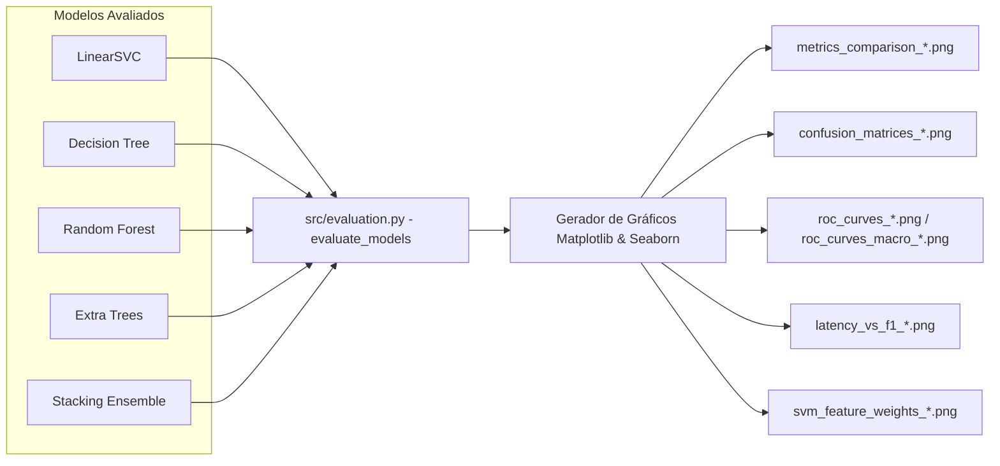

# Arquitetura do Sistema: Detecção de Tráfego Maligno e Benigno (AIDS - Stacking Ensemble)

## 1. Visão Geral

Este projeto consiste em um Sistema de Detecção de Intrusão Baseado em Anomalias e Assinaturas (**AIDS - Anomaly-based Intrusion Detection System**), cujo objetivo principal é classificar pacotes e fluxos de tráfego de rede entre **Maligno** (ataques como DoS/DDoS, Port Scan, Botnet, Brute Force, etc.) e **Benigno** (tráfego legítimo de rede).

O projeto suporta tanto a **Classificação Binária** (Maligno vs. Benigno) quanto a **Classificação Multiclasse** (identificação dos tipos específicos de ataque).

Para obter alta precisão, excelente poder de generalização e estabilidade em datasets de grande escala (ex: `data/CICFlowMeter_out.csv`), a solução emprega um algoritmo de **Stacking Ensemble (Aprendizado em Camadas)** combinando as capacidades complementares do **LinearSVC Calibrado** (separabilidade linear de alta velocidade com calibração isotônica), **Random Forest** (redução de variância por bagging), **Extra Trees** (fronteiras suaves por aleatorização extrema) e **Decision Tree** (regras ortogonais baseadas em entropia e poda ccp), utilizando a **Regressão Logística** como meta-classificador de Nível 1.

---

## 2. Requisitos de Ambiente de Execução e Configuração

### 2.1. Ambiente Virtual Obrigatório (Python venv)

É **estritamente obrigatório** o uso de um ambiente virtual Python isolado (`.venv`) para execução de qualquer comando de instalação, treinamento e avaliação no projeto.

- **Criação do Ambiente Virtual:**

  ```bash
  python -m venv .venv
  ```

- **Ativação:**
  - **Windows (PowerShell):** `.\.venv\Scripts\activate`
  - **Linux / macOS:** `source .venv/bin/activate`

### 2.2. Configuração Dinâmica via Arquivo `.env` (Pipeline Central de ML)

O comportamento do pipeline de treinamento e avaliação (`main.py`) é controlado dinamicamente via variáveis de ambiente carregadas do arquivo `.env` na raiz:

- `TRAIN_LINEARSVC` (bool, default `True`): Habilita o treinamento do modelo LinearSVC isolado.
- `TRAIN_DT` (bool, default `True`): Habilita o treinamento do modelo Decision Tree isolado (gera também `models/dt_pipeline_{mode}.joblib`).
- `TRAIN_RF` (bool, default `True`): Habilita o treinamento do modelo Random Forest isolado.
- `TRAIN_ET` (bool, default `False`): Habilita o treinamento do modelo Extra Trees isolado.
- `TRAIN_HGB` (bool, default `False`): Habilita o treinamento do modelo HistGradientBoosting isolado.
- `TRAIN_MLP` (bool, default `True`): Habilita o treinamento da Mini Rede Neural (MLPClassifier) isolada.
- `TRAIN_STACKING` (bool, default `True`): Habilita o treinamento do Stacking Ensemble.
- `STACKING_PROFILE` (str, default `'edge'`): Seleciona o perfil de estimadores do Stacking (`edge`, `balanced`, `performance`, `legacy`).
- `STACKING_CV_SPLITS` (int, default `5`): Quantidade de divisões no `StratifiedKFold` para geração out-of-fold das meta-features.
- `STACKING_PASSTHROUGH` (bool, default `False`): Concatenação das features originais pré-processadas com as meta-features de probabilidade no Meta-Learner.
- `STACKING_N_JOBS` (int, default `2`): Quantidade de processos simultâneos para validação cruzada do Stacking (padrão seguro 2 para evitar estouro de memória RAM e OOM killer no Linux).
- `RUN_BINARY` (bool, default `True`): Executa o pipeline no modo de classificação binária (Benigno vs Maligno).
- `RUN_MULTICLASS` (bool, default `False`): Executa o pipeline no modo de classificação multiclasse (classes específicas de ataque).
- `SAMPLE_FRAC` (float, default `0.1`): Fração de amostragem estratificada do dataset (ex: `0.01` para 1%, `0.1` para 10%, `1.0` para 100%).

### 2.3. Configuração Isolada no Edge (`raspberry_pi/.env`)

O monitoramento e inferência no Raspberry Pi (`raspberry_pi/rpi_detector.py` e `raspberry_pi/rpi_monitor.py`) utilizam um arquivo `.env` independente em `raspberry_pi/.env` (carregado com prioridade via `raspberry_pi/config.py`):

- **Captura e Inferência:**
  - `NETWORK_INTERFACE` (str, default `'eth0'`): Interface de rede a monitorar (ex: `eth0`, `wlan0`, `end0`).
  - `DETECTION_MODE` (str, default `'binary'`): Modo de operação do detector: `'binary'` (padrão de menor latência), `'multiclass'` ou `'cascade'` (cascata binária + DT multiclasse).
  - `ALERT_THRESHOLD` (float, default `0.50`): Limiar de corte de probabilidade para classificação de fluxo maligno.
  - `USE_DT_MULTICLASS_FOR_ATTACKS` (bool, default `True`): Quando detectado como malicioso no modo binário/cascata, aciona a Decision Tree multiclasse para rotular a família exata do ataque.
  - `DT_MULTICLASS_MODEL_PATH` (str, default `'models/dt_pipeline_multiclass.joblib'`): Caminho para o modelo/pipeline Decision Tree multiclasse.
  - `FLOW_INACTIVITY_TIMEOUT` (float, default `10.0`): Timeout em segundos para encerramento de fluxo inativo e envio para inferência.
  - `FLOW_ACTIVE_TIMEOUT` (float, default `60.0`): Duração máxima de um fluxo contínuo antes de forçar classificação intermediária.
  - `PORT_SCAN_THRESHOLD` (int, default `15`): Limiar de portas de destino distintas sondadas na janela de scan (5.0s) para acionar detecção heurística de Reconnaissance.
  - `CONN_FLOOD_THRESHOLD` (int, default `20`): Limiar de tentativas de conexão SYN na janela de flood (2.0s) para acionar detecção heurística de DoS.
  - `IGNORE_BROADCAST_MULTICAST` (bool, default `True`): Descarte automático de pacotes broadcast/multicast legítimos para evitar falsos positivos.
  - `IGNORE_LOCAL_DISCOVERY_PORTS` (str, default `'1900,5353,5355,137,138,27036,67,68'`): Portas de protocolos de descoberta local benignos ignoradas (SSDP, mDNS, LLMNR, NetBIOS, Steam, DHCP).
  - `DRY_RUN` (bool, default `False`): Executa o detector sem disparo real de alertas SMTP.
  - `LOG_FILE` (str, default `'logs/aids_rpi.log'`): Arquivo de log geral do processo Edge.

- **Alertas SMTP e Anti-Flood:**
  - `ALERT_EMAIL_ENABLED` (bool, default `True`): Habilita o despacho assíncrono de e-mails de alerta.
  - `SMTP_HOST` (str, default `'smtp.gmail.com'`), `SMTP_PORT` (int, default `587`).
  - `SMTP_USE_TLS` (bool, default `True`), `SMTP_USE_SSL` (bool, default `False`).
  - `SMTP_USER`, `SMTP_PASS`: Credenciais SMTP seguras (App Password de 16 dígitos para Google).
  - `ALERT_SENDER`, `ALERT_RECIPIENT`: Endereços de origem e destino dos alertas de segurança.
  - `COOLDOWN_SECONDS` (float, default `60.0`): Janela de supressão anti-flood para rajadas da mesma ameaça.

- **Auditoria e Logs Persistentes (`DetectionLogger`):**
  - `DETECTION_LOG_ENABLED` (bool, default `True`): Gravação em disco das detecções e fluxos.
  - `DETECTION_LOG_FILE` (str, default `'logs/detections.jsonl'`).
  - `DETECTION_LOG_FORMAT` (str, default `'jsonl'`): Formatos suportados: `'jsonl'`, `'csv'`, `'text'` ou `'all'`.
  - `DETECTION_LOG_MAX_BYTES` (int, default `5242880` / 5 MB): Limite por arquivo antes da rotação automática.
  - `DETECTION_LOG_BACKUP_COUNT` (int, default `3`): Número de cópias rotacionadas preservadas (.1, .2, .3).
  - `DETECTION_LOG_ALL_FLOWS` (bool, default `False`): Registrar apenas intrusões (False) ou todos os fluxos avaliados (True).

---

## 3. Arquitetura da Solução de Machine Learning

### 3.1. O Conceito de Stacking Ensemble

O Stacking combina múltiplos modelos de classificação (Base Learners - Nível 0) através de um meta-classificador (Meta Learner - Nível 1).

- **Nível 0 (Base Learners / Modelos Suportados no Stacking):**
  - **LinearSVC Calibrado (`CalibratedClassifierCV(LinearSVC(...), cv=3)`):** Modelo linear de alta velocidade com parâmetros `C=1.0`, `loss="squared_hinge"`, `dual="auto"`, `tol=1e-3`, `max_iter=5000` e `class_weight='balanced'`, empacotado para calibração de probabilidades de classe via validação cruzada tripla.
  - **HistGradientBoosting Classifier (`HistGradientBoostingClassifier`):** Ensemble de árvores com gradient boosting e binning de histograma configurado com `max_iter=100`, `max_depth=12`, `min_samples_leaf=20`, `learning_rate=0.1`, `class_weight='balanced'` e `random_state=42`. Foca iterativamente nos resíduos de predição, complementando o bagging de forma ortogonal.
  - **Random Forest Classifier (`RandomForestClassifier`):** Ensemble por bagging configurado com `n_estimators=100`, `max_depth=15`, `min_samples_split=4`, `min_samples_leaf=2`, `max_features='sqrt'`, `class_weight='balanced'`, `n_jobs=1` e `random_state=42`.
  - **Extra Trees Classifier (`ExtraTreesClassifier`):** Ensemble de árvores extremamente aleatórias configurado com `n_estimators=100`, `max_depth=15`, `min_samples_split=4`, `min_samples_leaf=2`, `max_features='sqrt'`, `class_weight='balanced'`, `n_jobs=1` e `random_state=42`.
  - **Decision Tree Classifier (`DecisionTreeClassifier`):** Árvore de decisão individual configurada com `criterion='entropy'`, `max_depth=15`, `min_samples_split=5`, `min_samples_leaf=2`, poda `ccp_alpha=0.0001`, `class_weight='balanced'` e `random_state=42` (suportada no perfil legacy).
  - **Mini Rede Neural (`MLPClassifier`):** Perceptron Multicamadas compacto de 2 camadas ocultas `(64, 32)`, ativação ReLU, otimizador Adam, regularização L2 (`alpha=0.0001`), `learning_rate='adaptive'`, `early_stopping=True` para convergência rápida e benchmark não-linear direto (suportada no perfil performance).

- **Perfis de Stacking Suportados (`STACKING_PROFILE`):**
  - `edge` (Padrão otimizado para Raspberry Pi): Combina `linearsvcCalibrated`, `hgb` e `rf`. Baixíssima latência de inferência em borda sem perda de acurácia.
  - `balanced`: Combina `linearsvcCalibrated`, `rf`, `et` e `hgb`.
  - `performance`: Combina `linearsvcCalibrated`, `rf`, `et`, `hgb` e `mlp`.
  - `legacy`: Combina `linearsvcCalibrated`, `rf`, `et` e `dt`.

- **Nível 1 (Meta-Learner):**
  - **Regressão Logística (`LogisticRegression`):** Configurada com `C=1.0`, `class_weight='balanced'`, `solver='lbfgs'`, `max_iter=2000` e `random_state=42`. Opera sobre probabilidades preditas na faixa `[0, 1]` geradas pelos estimadores de Nível 0.
- **Estratégia de Validação do Stacking:**
  - `StratifiedKFold(n_splits=5, shuffle=True, random_state=42)` (configurável via `STACKING_CV_SPLITS`) com `stack_method='auto'`, `passthrough=False` e `n_jobs` controlado dinamicamente via `STACKING_N_JOBS` (padrão `2`).

```mermaid
flowchart TD
    A[Dados de Tráfego de Rede - CICFlowMeter_out.csv] --> B[Remoção de Inf/NaN & Duplicados]
    B --> C[Amostragem Estratificada por SAMPLE_FRAC & Filtro de Classes Raras <5]
    C --> D[Remoção de Colunas Identificadoras & Constantes & Conversão float32]
    D --> E[ColumnTransformer: Imputer + VarianceThreshold + Scaler / OneHotEncoder]

    subgraph Nível 0 - Base Learners (Perfil Edge)
        E --> F[LinearSVC Calibrado - CalibratedClassifierCV cv=3]
        E --> G[HistGradientBoosting - Boosting por Histograma]
        E --> H[Random Forest Classifier - Bagging 100 estimadores]
    end

    F --> J[Probabilidades Calibradas LinearSVC]
    G --> K[Probabilidades HistGradientBoosting]
    H --> L[Probabilidades Random Forest]

    subgraph Nível 1 - Meta Learner
        J --> N["Meta-Classificador - Regressão Logística (class_weight='balanced')"]
        K --> N
        L --> N
    end

    N --> O{Classificação Final}
    O -->|Binary Mode| P[Benigno: 0 vs Maligno: 1]
    O -->|Multiclass Mode| Q[Classes Específicas de Ataque]

    N --> R[Salvamento via Joblib] --> S[Diretório ./models/]
```

---

## 4. Pipeline de Dados, Treinamento e Persistência

### 4.1. Estágios do Pipeline

1. **Ingestão e Amostragem de Dados de Rede (`src/data_loader.py`):**
   - Carregamento do dataset `data/CICFlowMeter_out.csv`.
   - Limpeza de espaços em branco nos nomes de colunas via `str.strip()`.
   - Substituição de valores infinitos (`inf`, `-inf`) por `NaN`, eliminação de registros com valores nulos (`dropna`) e remoção de registros duplicados (`drop_duplicates`).
   - Aplicação de amostragem estratificada controlada pela variável `SAMPLE_FRAC` do `.env` (com fallback automático para amostragem aleatória em caso de falha).
   - Filtragem de classes com menos de 5 amostras para assegurar a integridade e estabilidade da validação cruzada (`StratifiedKFold`).
   - Binarização do alvo no modo binário (`BENIGN` -> 0, qualquer outro -> 1) ou normalização de string no modo multiclasse.

2. **Limpeza e Seleção de Atributos (`src/preprocessing.py`):**
   - Remoção de colunas identificadoras de fluxo: `Flow ID`, `Src IP`, `Dst IP`, `Timestamp`.
   - Remoção de colunas com variância zero / constantes: `Bwd PSH Flags`, `Fwd URG Flags`, `Bwd URG Flags`, `URG Flag Count`, `CWR Flag Count`, `ECE Flag Count`, `Fwd Bytes/Bulk Avg`, `Fwd Packet/Bulk Avg`, `Fwd Bulk Rate Avg`.
   - Conversão e casting de atributos numéricos para `np.float32` e categóricos (`Protocol`) para `str`.

3. **Escalonamento e Pré-processamento (`ColumnTransformer` em `src/preprocessing.py`):**
   - **Pipeline Numérico (`scale_type='log_standard'` - Padrão de Produção):** `SimpleImputer(strategy='median')` $\rightarrow$ `VarianceThreshold(threshold=0.0)` $\rightarrow$ `FunctionTransformer(_log1p_clip)` (transformação logarítmica $\ln(1+\max(x, 0))$ para estabilizar atributos com variância extrema como durações, taxas e contagens) $\rightarrow$ `StandardScaler()`. *Modos alternativos suportados via código:* `robust` (`RobustScaler()`) e `standard` (`StandardScaler()`).
   - **Pipeline Categórico (`Protocol`):** `SimpleImputer(strategy='constant', fill_value='missing')` $\rightarrow$ `OneHotEncoder(handle_unknown='ignore', dtype=np.float32)`.

4. **Tratamento de Desbalanceamento:**
   - Uso de `class_weight='balanced'` nos estimadores base (`LinearSVC`, `RandomForest`, `ExtraTrees`, `DecisionTree`).

5. **Validação Cruzada & Out-of-Fold Predictions:**
   - Utilização de `StratifiedKFold(n_splits=5, shuffle=True, random_state=42)` (configurável via `STACKING_CV_SPLITS`) no `StackingClassifier` para geração de meta-features sem vazamento de dados (*data leakage*), com paralelização multiprocesso controlada via `STACKING_N_JOBS` (padrão seguro `2` para proteção de memória RAM).

6. **Persistência Estruturada de Modelos Treinados (`joblib` na pasta `./models/`):**
   - Salvamento dos artefatos serializados com sufixo do modo de alvo (`_binary` ou `_multiclass`):
     - `models/stacking_pipeline_{mode}.joblib`: Pipeline final unificado (Pré-processador `ColumnTransformer` + `StackingClassifier`).
     - `models/dt_pipeline_{mode}.joblib`: Pipeline completo Decision Tree (`ColumnTransformer` + `DecisionTreeClassifier`), versionado para inferência de segundo estágio no Edge.
     - `models/scaler_{mode}.joblib`: Objeto `ColumnTransformer` ajustado.
     - `models/meta_learner_{mode}.joblib`: Meta-modelo de Regressão Logística extraído do Stacking.
     - `models/LinearSVC_{mode}.joblib`: Modelo LinearSVC treinado.
     - `models/DT_{mode}.joblib`: Modelo Decision Tree treinado.
     - `models/RF_{mode}.joblib`: Modelo Random Forest treinado.
     - `models/ET_{mode}.joblib`: Modelo Extra Trees treinado.
     - `models/HGB_{mode}.joblib`: Modelo HistGradientBoosting treinado (se habilitado).
     - `models/MLP_{mode}.joblib`: Modelo Mini Rede Neural (MLPClassifier) treinado.
     - `models/Stacking_{mode}.joblib`: Stacking Classifier treinado.

---

## 5. Comparação e Avaliação Visual de Eficácia (Matplotlib & Seaborn)

O script de avaliação (`src/evaluation.py`) avalia os modelos treinados/carregados no conjunto de teste (*Hold-out Test Set* de 20%) e constrói relatórios visuais de alta resolução salvos no diretório `./results/`:

### 5.1. Visualizações Geradas via Matplotlib & Seaborn

1. **Gráfico de Barras Agrupadas - Comparativo de Métricas (`metrics_comparison_{mode}.png`):**
   - Exibe lado a lado: *Acurácia*, *Precisão*, *Recall* e *F1-Score* (com média macro em multiclasse).
   - Escala percentual (`0` a `120%`) com rótulos numéricos formatados (ex: `99.20%`) e rotacionados a 45° sobre as barras, com legenda posicionada externamente para evitar sobreposição.

2. **Grid de Matrizes de Confusão (`confusion_matrices_{mode}.png`):**
   - Renderização em subplots com `seaborn.heatmap` normalizados (0 a 1), exibindo taxas de acerto e erro por classe para cada modelo avaliado com rótulos descritivos (`Benigno` e `Maligno` no modo binário).

3. **Curva ROC e AUC Comparativa (`roc_curves_{mode}.png` / `roc_curves_macro_{mode}.png`):**
   - **Modo Binário:** Plot simultâneo das curvas ROC de todos os modelos com cálculo de AUC e painel de zoom (*inset plot*) no canto superior esquerdo ($FPR \in [-0.01, 0.1]$, $TPR \in [0.9, 1.01]$).
   - **Modo Multiclasse:** Plot da curva ROC com média macro (*Macro-Average ROC*) binarizada via `label_binarize` e painel de zoom embutido.

4. **Trade-off de Latência de Inferência vs. F1-Score (`latency_vs_f1_{mode}.png`):**
   - Scatter plot comparando a latência média de inferência (medida em milissegundos por 1.000 amostras) com o F1-Score obtido, incluindo anotação de texto com o nome do modelo.

5. **Pesos dos Coeficientes do SVM (`svm_feature_weights_{mode}.png`):**
   - **Modo Binário:** Gráfico de barras horizontais dos Top 25 atributos com maiores coeficientes absolutos no `LinearSVC`, diferenciados por cores (vermelho para indicação de ataque e azul para tráfego benigno) e valores anotados.
   - **Modo Multiclasse:** Heatmap dos pesos dos Top 25 atributos do `LinearSVC` discriminados por classe de ataque com mapa de cores divergente (`vlag`).



---

## 6. Requisitos Não-Funcionais

- **Ambiente Isolado:** Uso exclusivo do `.venv` para gerenciamento e execução de pacotes.
- **Configurabilidade:** Controle total das etapas do pipeline via variáveis no `.env`.
- **Persistência Estruturada:** Armazenamento garantido dos modelos em formato `.joblib` com identificação do modo (`_binary` / `_multiclass`) dentro de `./models/`.
- **Validação Visual Automática:** Geração de gráficos comparativos em `./results/` após a avaliação dos modelos.
- **Baixa Latência:** Inferência rápida otimizada para monitoramento em tempo real com medição de latência normalizada por 1.000 amostras.
- **Reprodutibilidade:** Fixação de sementes randômicas (`random_state=42`) em todo o pipeline.
- **Modularidade:** Pipeline estruturado de forma modular em `src/` (`data_loader.py`, `preprocessing.py`, `models.py`, `evaluation.py`), módulo Edge dedicado em `raspberry_pi/` e testes unitários automatizados em `tests/`.

---

## 7. Módulo Edge: Monitoramento em Tempo Real no Raspberry Pi (`raspberry_pi/`)

Para execução autônoma diretamente em dispositivos Edge / SBCs (*Raspberry Pi 3B+, 4B, 5 ou Zero 2 W*), o sistema disponibiliza o pacote dedicado `raspberry_pi/`:

### 7.1. Componentes do Módulo Edge

1. **Agregador e Extrator de Features em Tempo Real (`raspberry_pi/flow_aggregator.py`):**
   - Captura pacotes brutos IPv4 TCP/UDP via `scapy`.
   - Agrupa fluxos bidirecionais baseados na 5-tupla (*IP Origem, IP Destino, Porta Origem, Porta Destino, Protocolo*).
   - Extrai as 70 features estatísticas padronizadas do CICFlowMeter de forma contínua com encerramento por flags FIN/RST ou timeouts de inatividade (`FLOW_INACTIVITY_TIMEOUT`) e atividade máxima (`FLOW_ACTIVE_TIMEOUT`).
   - **Filtro de Tráfego Legítimo e Redução de Ruído:** Rejeição de pacotes broadcast (`255.255.255.255`, sub-redes `x.x.x.255`) e multicast (`224.0.0.0/4`, incluindo SSDP `239.255.255.250`, mDNS `224.0.0.251`), além de supressão configurável de portas de descoberta local benignas (`IGNORE_LOCAL_DISCOVERY_PORTS`: 1900, 5353, 5355, 137, 138, 27036, 67, 68), erradicando falsos positivos em redes locais domésticas/corporativas.
   - **Detecção Heurística / Híbrida em Tempo Real:**
     - *Port Scan (Reconnaissance):* Rastreamento de pacotes SYN de iniciação de clientes por par de hosts `(src_ip, dst_ip)` em janela deslizante de 5.0 segundos. Se o total de portas distintas sondadas atingir `PORT_SCAN_THRESHOLD` (padrão 15), o fluxo é classificado como `Reconnaissance` com 99% de confiança.
     - *Connection Flood (DoS):* Rastreamento de rajadas de tentativas de conexão TCP na mesma porta em janela de 2.0 segundos. Se o número de conexões atingir `CONN_FLOOD_THRESHOLD` (padrão 20), o fluxo é classificado como `DoS` com 99% de confiança.
   - Algoritmo de descarte LRU por capacidade para limitar o uso de memória RAM abaixo de 400 MB.

2. **Motor de Detecção em Cascata de Dois Estágios (`raspberry_pi/rpi_detector.py`):**
   - **Estágio 1 (Classificação Primária):** Avaliação com o pipeline Stacking Ensemble (`models/stacking_pipeline_binary.joblib`) no modo binário ou cascata (`DETECTION_MODE=binary` ou `cascade`) para distinguir tráfego Benigno vs Maligno com máxima velocidade.
   - **Estágio 2 (Especialização via Decision Tree Multiclasse):** Se o fluxo for classificado como malicioso (`is_attack=True`), o sistema consulta o pipeline de Decision Tree multiclasse (`models/dt_pipeline_multiclass.joblib`) para atribuir a classe específica de ataque (`DoS`, `Reconnaissance`, `Exploits`, `Fuzzers`, `Generic`, `Backdoor`, `Worms`, `Analysis`, `Shellcode`).
   - **Mecanismo de Resiliência e Fallback:** Se a predição majoritária (argmax) da DT for `Benign` (apesar do Estágio 1 ter detectado intrusão), o detector seleciona automaticamente a classe de ataque com maior probabilidade relativa entre as classes malignas da DT. Caso o modelo DT não esteja disponível, adota o rótulo descritivo `Maligno (Ataque Detectado)`.
   - **Avaliação Imediata de Fluxos Críticos:** Fluxos encerrados por FIN/RST ou que acionem as regras heurísticas de Port Scan / Connection Flood são avaliados imediatamente sem aguardar o timeout de inatividade, com controle de estado (`is_evaluated=True`) para impedir reavaliações redundantes durante flushes periódicos.

3. **Sistema de Log de Detecções e Auditoria Forense (`raspberry_pi/detection_logger.py`):**
   - Gravação persistente e thread-safe de intrusões e pacotes detectados.
   - Suporte a múltiplos formatos: **JSON Lines (`jsonl`)**, **CSV (`csv`)** e **Texto (`text`)**, com opção simultânea (`all`).
   - Mecanismo de **rotação automática de arquivos por tamanho (`RotatingFileHandler`)** com limite em bytes (`DETECTION_LOG_MAX_BYTES`) e retenção de backups (`DETECTION_LOG_BACKUP_COUNT`) para preservar o cartão SD do Raspberry Pi.
   - **Esquema Enriquecido no Formato JSONL:** Registra `timestamp`, `epoch`, `event`, `attack_type`, `is_attack`, `confidence`, `confidence_pct`, `dt_attack_type`, `dt_confidence`, `dt_probabilities`, 5-tupla (`source` e `destination`), métricas do fluxo (`duration_sec`, `total_packets`, `total_bytes`, `packets_per_sec`, `bytes_per_sec`), flags TCP e regra de mitigação recomendada (`iptables`).
   - Filtro configurável: apenas intrusões detectadas (padrão) ou todos os fluxos avaliados (`DETECTION_LOG_ALL_FLOWS`).

4. **Gerenciador de Alertas por E-mail com Anti-Flood (`raspberry_pi/email_alert.py`):**
   - Despacho assíncrono via `threading.Thread` para não bloquear a captura de pacotes na interface de rede.
   - Envio via **SMTP Seguro (STARTTLS 587 / SSL 465)** com suporte a autenticação por senha de aplicativo (App Password).
   - Template duplo (HTML responsivo moderno + Texto Puro) contendo IPs, portas, probabilidade do ataque, estatísticas de tráfego e comandos de firewall recomendados (`iptables`).
   - Mecanismo de **Cooldown / Throttling** configurável (`COOLDOWN_SECONDS`, padrão: 60s) para supressão e agregação de rajadas de alertas durante ataques volumosos (DDoS / Port Scan).

5. **Motor Edge e CLI (`raspberry_pi/rpi_detector.py` / `raspberry_pi/rpi_monitor.py` / `rpi_monitor.py`):**
   - Suporte a captura ao vivo (`--interface eth0`), modos (`--mode binary|multiclass|cascade`), modo simulação (`--dry-run`), replay de arquivos PCAP (`--pcap arquivo.pcap`), teste SMTP (`--test-email`) e customização de logs (`--detection-log`, `--detection-log-format`, `--log-all-flows`).

6. **Simulador de Tráfego Sintético de Laboratório (`simulate_traffic.py`):**
   - Ferramenta interativa de validação e testes em ambiente controlado, simulando 6 padrões de ataque inofensivos:
     1. *Fuzzers:* Pacotes HTTP com URIs fuzzeadas e cabeçalhos aleatórios em rajadas rápidas.
     2. *Força Bruta / Autenticação Repetida:* Tentativas de login padronizadas em portas de serviço (Analysis / Generic).
     3. *Backdoor / C2 Beaconing:* Batimentos periódicos de comunicação com intervalo estritamente uniforme (Flow IAT Std tendendo a zero).
     4. *Worm Propagation:* Varredura horizontal da sub-rede local LAN em portas SMB (445) ou HTTP (80).
     5. *DoS Flood:* Inundação de conexões TCP rápidas para validação do limiar heurístico `is_conn_flood`.
     6. *Reconnaissance:* Varredura vertical em múltiplas portas sequenciais para validação da regra `is_port_scan`.

7. **Serviço de Inicialização Automática e Deploy em Produção (`setup_rpi.sh` & `aids-rpi.service`):**
   - Script automatizado de provisionamento que prepara o Raspberry Pi do zero:
     - Instalação de pacotes Linux de rede (`libpcap-dev`, `tcpdump`, `iptables-persistent`, `netfilter-persistent`, etc.).
     - Migração e estruturação do projeto em `/etc/aids`.
     - Criação isolada do ambiente virtual em `/etc/aids/.venv` e instalação via `python3 -m pip`.
     - Atribuição de permissões de baixo nível via Linux Capabilities (`CAP_NET_RAW`, `CAP_NET_ADMIN`) ao Python.
     - Habilitação de roteamento IPv4 e NAT Masquerade (`iptables`).
     - Instalação e habilitação do serviço `systemd` (`aids-rpi.service`) para inicialização autônoma no boot do sistema operacional com reinício automático (`Restart=always`).

```mermaid
flowchart TD
    subgraph Raspberry Pi - Edge Runtime
        Pcap[Interface de Rede eth0 / wlan0] --> Sniff[Scapy Packet Sniffer]
        Sniff --> FilterCheck{Broadcast / Multicast / Portas Locais?}
        FilterCheck -->|Sim / Legítimo| DiscardAmbient[Descarte Imediato sem Custo de CPU]
        FilterCheck -->|Não| Agg[FlowAggregator - 5-Tuple & 70 Features]

        Agg --> HeuristicCheck{Port Scan ou DoS Flood Detectado?}
        HeuristicCheck -->|Sim: Scan| SetScan[Marca Reconnaissance - Confiança 99%]
        HeuristicCheck -->|Sim: Flood| SetFlood[Marca DoS - Confiança 99%]
        HeuristicCheck -->|Não| Pre[ColumnTransformer: Log1p + StandardScaler]

        Pre --> Stack[Stacking Ensemble Classifier - Estágio 1]
        Stack --> Decision{Probabilidade Maligna >= 0.50?}

        SetScan --> AlertFork
        SetFlood --> AlertFork

        Decision -->|Sim: Maligno| CascadeCheck{USE_DT_MULTICLASS Ativo?}
        Decision -->|Não: Benigno| DiscardCheck{Log All Flows Ativo?}

        CascadeCheck -->|Sim| DT[DT Multiclasse - Estágio 2: Tipo Exato de Ataque]
        CascadeCheck -->|Não| GenericLabel[Rotula como Maligno Genérico]
        DT --> AlertFork[Disparo de Resposta a Incidentes]
        GenericLabel --> AlertFork

        DiscardCheck -->|Sim| DetLog[DetectionLogger - JSONL / CSV / TEXT]
        DiscardCheck -->|Não| Discard[Descarte Normal]

        AlertFork --> DetLog
        DetLog --> Rot[Rotação Automática de Arquivos em Disco]
        
        AlertFork --> AlertMgr[EmailAlertManager]
        AlertMgr --> Throttling{Cooldown Ativo?}
        Throttling -->|Sim| Suppress[Agregação e Supressão de Alerta]
        Throttling -->|Não| SMTP[SMTP TLS/SSL - Disparo Assíncrono]
        SMTP --> Mail[E-mail de Alerta com Detalhes e Regra iptables]
    end
```



---

### 7.2. Configuração de Rede: Raspberry Pi como Gateway Padrão (Método 1)

Para garantir que a engine de detecção (`RPIDetector`) analise **todo o tráfego da rede doméstica**, o Raspberry Pi é configurado como o **Gateway Padrão (Default Gateway)** da rede LAN:

1. **IP Estático no Raspberry Pi:**
   - Atribuição de um IP estático na interface de rede (ex: `192.168.1.2/24` na `eth0` ou `wlan0`).

2. **Habilitação do Encaminhamento de IP (IP Forwarding):**
   ```bash
   sudo sysctl -w net.ipv4.ip_forward=1
   # Para persistência em /etc/sysctl.conf:
   # net.ipv4.ip_forward=1
   ```

3. **Configuração de NAT / Masquerade via iptables:**
   - Permite que o Raspberry Pi roteie pacotes da LAN para a Internet:
   ```bash
   sudo iptables -t nat -A POSTROUTING -o eth0 -j MASQUERADE
   sudo iptables -A FORWARD -i eth0 -m state --state RELATED,ESTABLISHED -j ACCEPT
   sudo iptables -A FORWARD -j ACCEPT
   ```

4. **Ajuste do Servidor DHCP no Roteador Principal:**
   - Alteração do campo **Default Gateway** (Gateway Padrão) nas configurações DHCP do roteador doméstico para o IP do Raspberry Pi (`192.168.1.2`).
   - Com essa alteração, todo o tráfego gerado pelos dispositivos da casa é direcionado ao Raspberry Pi antes de sair para a internet, permitindo inspeção em tempo real e extração de fluxos pelo `Scapy` e `FlowAggregator`.

---

## 8. Suíte de Testes Automatizados (Unittest)

A estabilidade e integridade funcional do projeto são garantidas por uma suíte com **40 testes unitários automatizados** localizados no diretório `tests/`:

- `tests/test_rpi_detector.py` (22 testes):
  - Agregação de fluxos TCP e UDP bidirecionais com verificação de 5-tupla e flags TCP.
  - Conformidade das 70 features extraídas com o padrão oficial do CICFlowMeter.
  - Expiração de fluxos por inatividade (`FLOW_INACTIVITY_TIMEOUT`) e descarte por capacidade de memória LRU.
  - Inferência no detector primário (Stacking) e detecção em cascata com DT Multiclasse (Estágio 2).
  - Mecanismo de fallback quando o argmax da DT for `Benign`.
  - Classificação heurística imediata para Port Scan (`Reconnaissance`) e Connection Flood (`DoS`).
  - Prevenção de reavaliação duplicada de fluxos após pacotes RST/FIN.
  - Filtragem e descarte de tráfego multicast (SSDP, mDNS) e broadcast (subnet e limited broadcast).
  - Permissão e extração correta de fluxos unicast legítimos.
- `tests/test_detection_logger.py` (10 testes):
  - Gravação estruturada em formato JSON Lines (`jsonl`), CSV e Texto.
  - Rotação automática de arquivos por estouro do limite de bytes (`DETECTION_LOG_MAX_BYTES`).
  - Gravação segura e concorrente em múltiplos threads.
  - Integração do `RPIDetector` com o `DetectionLogger` em tempo de execução.
- `tests/test_models.py` (6 testes):
  - Inicialização e validação de todos os estimadores de base (`linearsvc`, `rf`, `et`, `dt`, `mlp`, `hgb`, `linearsvcCalibrated`).
  - Arquitetura da Mini Rede Neural MLP (`hidden_layer_sizes=(64, 32)`).
  - Meta-classificador de Regressão Logística com `class_weight='balanced'`.
  - Perfis do Stacking Ensemble (`edge`, `balanced`, `legacy`).
  - Extração de coeficientes e interpretabilidade do Meta-Learner.
- `tests/test_preprocessing.py` (2 testes):
  - Descarte de colunas identificadoras e constantes de variância zero.
  - Construção e transformação pelo `ColumnTransformer` com `log_standard` e `robust`.


